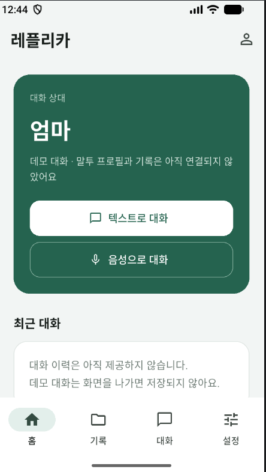
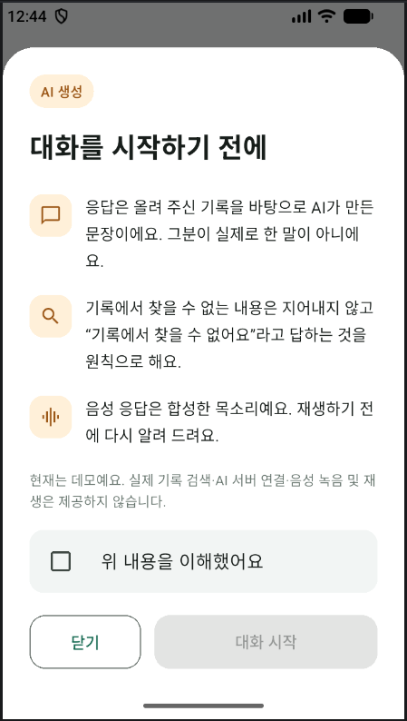
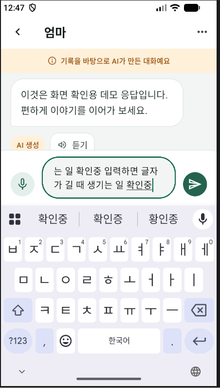
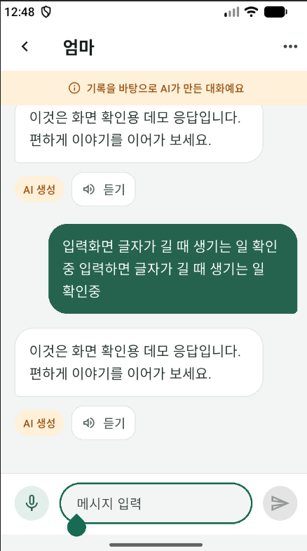

# 이슈 #4 검증 기록

갱신일: 2026-10-14 (Asia/Seoul)

## 검증 대상과 근거

- 앱 코드: PR #24의 `2b60ebaf4b98e0dbc3019700f7bd0152d3f8216d`.
- 아래 웹 검증은 리뷰어 Just-Simple0이 위 커밋을 직접 확인한 결과다.
- Android 검증은 사용자가 입력·전송을 직접 확인했다고 보고한 내용과 제공한 스크린샷 4장을 근거로 기록한다. Codex가 기기를 직접 조작하거나 재실행한 결과가 아니다.
- 이번 반영은 검증 문서와 원본 캡처 추가이며 앱 코드는 변경하지 않았다.

## 최신 코드 웹 검증 (리뷰어 확인)

[2026-10-14 리뷰](https://github.com/Aurelia-aurity/Replica/pull/24#pullrequestreview-5517490867)

- Flutter 3.47.5 / Dart 3.13.4.
- flutter analyze: 통과.
- 기존 자동 테스트 10개: 통과.
- 웹 빌드: 통과.
- 홈 → AI 안내 이해 확인 → 텍스트 대화 진입 및 데모 응답: 정상.
- 텍스트·음성 화면 전환 시 대화 및 미전송 입력 유지: 정상.
- 음성 미연결 안내와 AI 안내창 취소: 정상.
- 확인한 웹 데모 흐름에서 진행을 막는 문제를 발견하지 않았다는 리뷰어 보고.

## Android 키보드 입력·전송 (사용자 확인)

사용자가 Android에서 키보드가 열린 상태의 입력과 전송을 확인하고 캡처를 제공했다.

| 항목 | 확인 결과와 근거 |
| --- | --- |
| 홈 화면 | 상대 카드, 대화 시작 버튼, 하단 탭 표시 (캡처 1) |
| AI 안내 | 안내 내용, 이해 확인 체크, 미확인 상태의 시작 버튼 비활성 표시 (캡처 2) |
| 키보드 열린 상태 | 한글 키보드와 입력창이 동시에 표시되며 전송 버튼이 키보드에 가려지지 않음 (캡처 3) |
| 긴 한글 입력 | 여러 줄 입력이 입력창의 제한된 높이 안에 표시됨 (캡처 3) |
| 메시지 전송 | 사용자 확인 보고 및 전송된 긴 메시지 말풍선 표시 (캡처 4) |
| 응답·입력 초기화 | 데모 응답과 AI 생성 배지 표시, 빈 입력창과 전송 버튼 비활성 표시 (캡처 4) |
| 화면 배치 | 제공된 세로 화면 범위에서 입력·전송을 가리는 요소나 Flutter overflow 오류 표시가 보이지 않음 |

### 환경과 확인 한계

- 플랫폼: 사용자 제공 정보 기준 Android.
- 기기 모델, Android 버전, 실제 기기/에뮬레이터 여부, 앱 빌드 종류·실행 명령·실행 커밋: 제공되지 않아 미기록.
- 캡처에서 기기 모델·OS 버전·논리 화면 크기를 추정하지 않는다.
- 가로 화면, 큰 글자 설정, 여러 화면 크기의 반복 시험은 미검증.
- iOS 실행·빌드: 미검증.
- 실제 백엔드·LLM·STT·TTS·음성 권한 및 재생은 아직 구현 범위 밖이며, 이 캡처는 데모 응답 검증이다.
- 자동 테스트 및 앱 실행은 이번 문서 갱신 과정에서 별도로 수행하지 않았다.

### 첨부 캡처

사용자가 제공한 PNG 원본을 수정하지 않고 저장했다. 예시 대화 및 테스트 입력이며 실제 개인 기록은 포함하지 않는다.

#### 1. 홈

#### 2. AI 생성 안내

#### 3. 키보드가 열린 상태의 긴 한글 입력

#### 4. 전송된 메시지와 데모 응답

## 구현 범위와 후속 작업

SC-02 홈 → SC-08 안내 → SC-09 텍스트 / SC-10 음성 화면 틀을 제공한다. 음성↔텍스트 전환 시 같은 메모리 세션을 유지한다.

API 명세 합의 후 실제 서버 연결, 녹음·STT·TTS·음성 재생을 구현한다. 로그인·기록 관리·프로필·이력 등 고도화 기능은 별도 이슈에서 진행한다. 기기·OS 정보 보완, iOS 및 가로 화면·큰 글자·추가 화면 크기 검증은 후속 확인으로 남긴다.

## 이전 구현 검증 이력

2026-10-09, Windows 11 / Flutter 3.47.5 stable / Dart 3.13.4 환경에서 SC-09 구현 단계의 flutter analyze와 테스트 10개가 통과했다. 이후 홈·AI 안내·음성 화면 추가 직후에는 사용자 요청에 따라 검사하지 않았다. 해당 미검증 기록은 위 2026-10-14 리뷰어 웹 검증 및 사용자 Android 확인으로 갱신했다.
